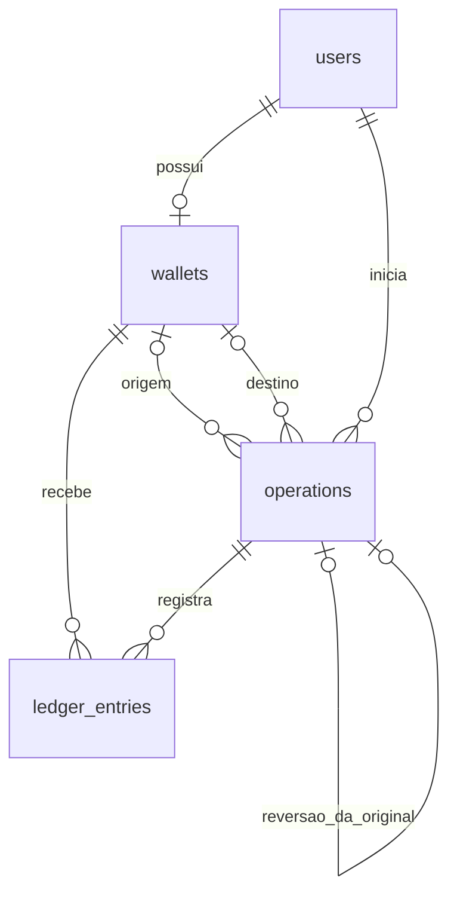

# Arquitetura da carteira financeira

A etapa 02 adicionou esquema relacional e models; a etapa 03 implementou cadastro e sessão; a etapa 04A implementou o núcleo financeiro em `WalletService`. A etapa 04B integra esse serviço à interface Blade por rotas autenticadas, Form Requests e controller financeiro. Os testes usam o MySQL `testing`.

## Estrutura MVC e responsabilidades

- `routes/`: agrupa visitantes em `guest` e dashboard, logout e ações financeiras em `auth`, sem lógica de aplicação nas closures.
- `app/Http/Controllers/`: coordena entrada e resposta; `WalletController` resolve destinatário por e-mail e delega toda movimentação ao `WalletService`. Nenhum controller calcula ou modifica saldos financeiros.
- `app/Models/`: dados, casts e relacionamentos Eloquent; nenhuma movimentação automática.
- `resources/views/`: layout compartilhado e páginas em Blade/Bootstrap 5 local; dashboard com formulários, saldo e extrato.
- `database/migrations/`: evolução e integridade do esquema; migrations padrão executadas permanecem intactas.
- `tests/Feature/WalletSchemaTest.php`: restrições verificadas no MySQL `testing`, com fixtures revertidas por transação, sem reset de banco.
- `app/Services/WalletService.php`: coordena depósitos, transferências, reversões, autorização de domínio, locks, idempotência e persistência financeira.
- `app/Exceptions/Wallet/`: diferencia rejeições de domínio e falhas de persistência, com mensagens públicas sem SQL.
- `tests/Feature/WalletServiceTest.php`: valida casos de uso, falhas transacionais, replay, integridade dos lançamentos e limites monetários no MySQL `testing`.

Usar Eloquent e os recursos transacionais do Laravel. Form Requests validam entradas de autenticação e financeiras. A autorização de movimentação é revalidada pelo `WalletService`; não há Policy/Gate adicional nesta etapa. Não adicionar repositórios, interfaces ou patterns sem necessidade concreta.

## Cadastro e autenticação implementados na etapa 03

`RegisterRequest` valida nome, e-mail único normalizado e senha confirmada. `RegisteredUserController` recebe o serviço concreto `RegisterUser` por injeção de dependência. Esse serviço usa `DB::transaction()` para criar usuário com `Hash::make()` e uma carteira vinculada ao usuário recém-criado, com zero centavos. Uma falha na carteira desfaz também o usuário; não cria operação ou lançamento inicial. A restrição única de usuário continua impedindo carteiras duplicadas.

O controller inicia a sessão somente após o serviço retornar com sucesso. Falhas SQL do cadastro geram mensagem genérica sem expor ou registrar SQL, parâmetros ou hashes de senha. Não há observer de `User`: factories e usuários antigos não recebem carteiras silenciosamente. `RegisterUser` continua responsável apenas pelo cadastro; `WalletService` é um serviço separado para movimentações.

`LoginRequest` valida credenciais e usa `Auth::attempt()` com o guard `web`, provider Eloquent e sessão nativa. Mensagens de falha não distinguem e-mail inexistente de senha incorreta. RateLimiter nativo limita cinco falhas por e-mail/IP e vinte por IP em 60 segundos, com chaves em hash. O sucesso limpa o contador do par; não elimina o limite global do IP. `PasswordByteLimit` é uma regra compartilhada pelos dois formulários para rejeitar mais de 72 bytes e evitar truncamento do bcrypt.

Após login/cadastro, a sessão é regenerada. Logout é somente POST autenticado, chama `logout()`, invalida a sessão e regenera CSRF. Formulários usam `@csrf`, e senhas nunca usam `old()` nem são registradas em logs pela aplicação. Não há recuperação de senha ou autenticação persistente por remember-me.

`DashboardController` consulta exclusivamente `$request->user()->wallet()`. Parâmetros `user_id`/`wallet_id` da requisição não selecionam registros. Carteira ausente em usuários antigos produz mensagem e não cria dados na consulta. `BrazilianCurrency` formata centavos como texto, sem float e cobrindo os limites de inteiro de 64 bits. Os valores exibidos são escapados pelo Blade.

O frontend usa Bootstrap 5.3.8, CSS próprio e o componente Collapse para navegação móvel. Vite compila todos os assets locais, sem CDN ou fontes externas. A interface financeira da etapa 04B reutiliza o serviço existente. A separação entre Request, controller, serviço, model e apresentação aplica responsabilidade única. Eloquent e os serviços concretos atendem à persistência e aos casos de uso atuais.

## Entidades e relacionamentos

| Model | Responsabilidade e relacionamentos |
| --- | --- |
| `User` | Reutiliza `users`; `wallet()` é `HasOne`. |
| `Wallet` | Pertence ao usuário via `user()`; possui `ledgerEntries()`; guarda saldo materializado. |
| `Operation` | Registro de movimentação confirmada; `initiatedByUser()`, `sourceWallet()`, `destinationWallet()`, `ledgerEntries()`, `originalOperation()` e `reversal()`. |
| `LedgerEntry` | Débito ou crédito; pertence a `operation()` e `wallet()`. |

A FK única de usuário garante **no máximo uma** carteira, não obriga a existência de uma. O fluxo de cadastro da etapa 03 cria usuário e carteira atomicamente; usuários antigos não são alterados nem recebem carteira automaticamente.

Models financeiros mantêm a proteção padrão do Eloquent contra mass assignment. `WalletService` monta atributos internos validados e os atribui explicitamente. Não passar `request()->all()` a `create()`, `update()` ou `forceFill()`. `forceCreate()` aparece apenas nas fixtures.

## Tipos, restrições e índices

Valores monetários usam `BIGINT` assinado e casts PHP `integer`, no runtime de 64 bits. O intervalo é −9.223.372.036.854.775.808 a 9.223.372.036.854.775.807 centavos. A entrada e as somas futuras precisam validar limites antes de operar, evitando overflow. Não usar `FLOAT`, `DOUBLE` ou aritmética monetária de ponto flutuante.

| Tabela | Integridade e índices |
| --- | --- |
| `wallets` | PK `id`; FK `user_id → users.id`; `UNIQUE(user_id)`; `balance_cents` assinado, default 0, aceita negativo. |
| `operations` | PK `id`; FKs para iniciador, origem, destino e operação original; `UNIQUE(idempotency_key)` global; `UNIQUE(reversal_of_operation_id)` nullable; índices `(initiated_by_user_id, created_at)`, `(source_wallet_id, created_at)` e `(destination_wallet_id, created_at)`. |
| `ledger_entries` | PK `id`; FKs para operação e carteira; `UNIQUE(operation_id, wallet_id)`; índice `(wallet_id, created_at)` para extratos. |

Todas as FKs financeiras são restritivas na exclusão e na atualização de identificadores, sem `CASCADE` ou `SET NULL`. Nas FKs de `operations` usadas em `CHECK`s, omitir ações referenciais usa o padrão `NO ACTION`, equivalente a `RESTRICT` no InnoDB. Isso evita a limitação do MySQL para ações referenciais explícitas em colunas de `CHECK`.

O Schema Builder do Laravel 12 não fornece uma API de `CHECK`; as migrations usam `DB::statement()` com SQL estático, direcionado a MySQL 8.4. Os testes de esquema não usam SQLite.

Oito `CHECK`s são aplicados:

1. `operations_amount_positive`: valor maior que zero.
2. `operations_type_valid`: `deposit`, `transfer` ou `reversal`.
3. `operations_status_valid`: `completed` ou `reversed`.
4. `operations_reversal_completed`: reversão permanece `completed`.
5. `operations_idempotency_not_blank`: chave não vazia nem composta apenas por espaços.
6. `operations_reversal_reference`: apenas reversões possuem referência original, obrigatória nesse caso.
7. `operations_wallet_shape`: depósito tem apenas destino; transferência tem duas carteiras distintas; reversão tem ao menos uma carteira e, se houver duas, são distintas.
8. `ledger_entries_delta_nonzero`: lançamento diferente de zero.

`type`, `status` e `idempotency_key` usam `utf8mb4_bin`, sensível a maiúsculas/minúsculas. O serviço exige chave UTF-8 não vazia de até 128 caracteres, sem whitespace nas extremidades nem controles ASCII. Não normaliza a chave e compara o texto exato no replay, evitando tratar como iguais chaves legadas diferentes pela semântica de espaços finais do MySQL. Recomenda-se UUID canônico para clientes, sem impor esse formato.

## Ciclo de vida e auditoria

Depósitos e transferências são persistidos como `completed` na mesma transação que grava lançamentos e saldos. Não há estados `pending` ou `failed`: falha antes do commit desfaz todas as escritas e poderá gerar logs sanitizados.

Uma reversão cria outra operação `completed`, referencia a original e insere lançamentos compensatórios. Na mesma transação, a original muda para `reversed`. Seus valores, participantes, chave e lançamentos permanecem intactos. `updated_at` registra a mudança de estado; a compensação tem timestamps próprios.

`reversed` é terminal. Uma operação de tipo `reversal` não poderá ser revertida. A referência original única impede múltiplas reversões; como só se registram reversões confirmadas, não é necessário índice parcial por status.

## API pública do WalletService

Todos os métodos retornam `Operation`, com a relação `ledgerEntries` carregada. O ator é o `User` autenticado fornecido pelo controller via `$request->user()`; o serviço continua independente de HTTP e da facade Auth.

| Método | Responsabilidade |
| --- | --- |
| `deposit(User $actor, mixed $amountCents, string $idempotencyKey): Operation` | Descobre a carteira do ator, credita o valor e registra depósito/lançamento. Não recebe carteira de terceiros. |
| `transfer(User $actor, int $destinationWalletId, mixed $amountCents, string $idempotencyKey): Operation` | Descobre a origem pelo ator; destino é ID de **carteira**, não de usuário; exige outro proprietário e saldo suficiente. |
| `reverse(User $actor, int $originalOperationId, string $idempotencyKey): Operation` | Carrega original e participantes no servidor, valida autorização, compensa lançamentos e altera somente o status da original. |

`mixed` nos valores é intencional: a fronteira exige `is_int()` e rejeita strings, floats, booleanos, zero e negativos com `InvalidAmount`. Uma assinatura `int` isolada permitiria coerção silenciosa por chamadores PHP sem `strict_types`. Após a validação, os auxiliares monetários recebem somente inteiros. O runtime deve ser de 64 bits. Os Form Requests financeiros usam `ReaisToCents` para validar e converter a representação de entrada respeitando BIGINT.

## Transações e bloqueios implementados

Cada chamada usa `DB::transaction()`, incluindo operação, lançamentos, saldos e, em reversões, status da original. O estado `completed` é escrito dentro da transação e só fica visível após o commit. Falhas desfazem também a operação recém-inserida; lacunas de AUTO_INCREMENT após rollback são normais.

As carteiras são bloqueadas por consultas individuais à PK com `lockForUpdate()`, em ordem crescente de `id`. Isso torna a ordem de aquisição explícita, sem depender do plano de execução de `WHERE IN`. Propriedade, saldo disponível e aritmética são verificados nos registros bloqueados. A soma testa limites antes de calcular, impedindo promoção a float por overflow/underflow.

Reversões bloqueiam primeiro a original, validam iniciador/tipo, bloqueiam as carteiras em ordem crescente e revalidam a propriedade da carteira original do ator. O replay usa leitura com bloqueio antes de rejeitar status `reversed`. Uma nova reversão exige original `completed`; a referência única é a garantia final contra duplicação.

O serviço verifica se os lançamentos da original correspondem exatamente ao tipo, valor e participantes persistidos, usando leitura bloqueada. Histórico ausente ou adulterado produz `LogicException`, sem compensar valores indevidos. Os lançamentos compensatórios têm sinais opostos e permitem saldo negativo, mas respeitam BIGINT. Valor, participantes e lançamentos originais permanecem intactos.

O Laravel pode repetir a unidade transacional até três vezes nos erros de concorrência suportados por `DB::transaction`. Os modelos são recarregados dentro de cada tentativa. Ordenação reduz deadlocks; não elimina todos, incluindo os causados por índices únicos/gap locks.

## Idempotência e recuperação de colisões

1. Montar dados canônicos no servidor: iniciador, tipo, valor, origem, destino, chave e referência original.
2. Procurar replay; comparar ator e todos esses dados. Status é excluído da comparação para permitir repetir uma original já `reversed`, sem novo efeito.
3. Para uma chamada nova, bloquear carteiras e inserir a operação antes da validação dependente do saldo e antes de qualquer alteração financeira. Isso reserva a chave pelo `UNIQUE`.
4. Caso uma concorrente já tenha usado a chave, a violação 1062 sai de `DB::transaction`, que desfaz a tentativa perdedora. O serviço não continua a transação falha.
5. Somente para o índice `operations_idempotency_key_unique`, iniciar uma nova tentativa com leitura atual `FOR UPDATE` e recuperar a vencedora. A leitura atual evita um snapshot antigo em REPEATABLE READ. Se não houver vencedora visível, falhar sem criar outra movimentação.
6. Retornar a mesma operação apenas se ator e conteúdo coincidirem; caso contrário, lançar `IdempotencyConflict` genérico, sem devolver dados de outro usuário.

A recuperação de colisão é limitada a uma nova unidade transacional. A detecção utiliza o nome do índice no final do erro nativo do MySQL; não interpreta valores do cliente como nomes de índices. Uma duplicidade em `ledger_entries` não vira replay nem sucesso. Uma duplicidade da referência original vira `OperationAlreadyReversed` após rollback.

## Falhas e exceções

As classes em `app/Exceptions/Wallet` distinguem valor/chave inválidos, carteira ausente, falta de autorização, saldo insuficiente, conflito idempotente, operação inválida/já revertida e limite de saldo. `FinancialPersistenceException` sinaliza falha SQL ou cancelamento de `save()` por evento Eloquent, com mensagem pública genérica. A causa SQL fica em `previous` para diagnóstico interno. `WalletController` traduz essas falhas em mensagens de formulário e limita o log inesperado à classe, arquivo e linha.

Não há catch de `Throwable` retornando sucesso. Erros de programação e integridade histórica propagam após rollback. Nenhuma senha, sessão ou credencial é registrada pelo serviço. O chamador só recebe sucesso após a transação controlada pelo serviço concluir.

## Limites para revisão

- Os testes financeiros usam MySQL e rollback externo, preservando dados existentes. A simulação de uma primeira leitura vazia exercita INSERT, UNIQUE, rollback e recuperação reais, mas **não é um teste de concorrência com processos/conexões independentes**. Não há comprovação experimental de todos os interleavings nem teste de carga.
- O uso normal deve deixar o serviço controlar a transação externa. Chamadas aninhadas usam savepoints; o commit final pertence ao chamador externo, que também deve tratar a repetição de toda a transação em caso de deadlock. Liberar um savepoint não equivale a um commit durável nem necessariamente libera todos os locks.
- A igualdade saldo/soma dos lançamentos é preservada a partir de cadastro com zero e histórico consistente. Não há conciliação completa de todo o extrato a cada operação nem reparação de saldo adulterado por SQL. Os testes verificam essa igualdade, inclusive nos extremos de BIGINT.
- O serviço autoriza com base no ator recebido; as rotas HTTP exigem autenticação e o controller nunca aceita um iniciador escolhido no formulário.
- Não há triggers/observers financeiros. A unicidade `(operation_id, wallet_id)` assume um lançamento por carteira em cada operação. Depósitos são entradas simuladas, sem conta externa de contrapartida; não é uma contabilidade geral de partidas dobradas.
- FKs impedem exclusões de pais, mas não tornam folhas imutáveis contra SQL direto. Models retornados devem ser tratados como histórico pelos chamadores. Não há API de exclusão/edição financeira no serviço.

Ver [BUSINESS_RULES.md](BUSINESS_RULES.md) para o contrato de autorização. A camada HTTP traduz exceções para respostas sanitizadas e valida sua entrada, sem enfraquecer as regras do serviço.

## Organização e segurança

O phpMyAdmin oficial `phpmyadmin:5.2.3-apache` publica apenas `127.0.0.1:8089`, na rede `sail`, apontando a `mysql:3306`. Usa login normal por cookie, sem `PMA_USER`/`PMA_PASSWORD`. Utilizar a conta de desenvolvimento do `.env`; não adicionar armazenamento de configuração do phpMyAdmin nem modificar o volume MySQL.

Não registrar credenciais ou conteúdo do `.env` em logs, respostas e commits. A conta MySQL local permite manutenção de esquema; uma futura produção exigirá permissões mínimas e proteção específica do histórico. Não operar dados financeiros reais nesta simulação.

Referências: [migrations Laravel 12](https://laravel.com/docs/12.x/migrations), [CHECKs MySQL 8.4](https://dev.mysql.com/doc/refman/8.4/en/create-table-check-constraints.html), [imagem oficial phpMyAdmin](https://hub.docker.com/_/phpmyadmin) e [OWASP Top 10:2025](https://owasp.org/Top10/2025/).

Referências da etapa 03: [autenticação nativa Laravel 12](https://laravel.com/docs/12.x/authentication), [RateLimiter](https://laravel.com/docs/12.x/rate-limiting) e [Bootstrap com Vite](https://getbootstrap.com/docs/5.3/getting-started/vite/).

Referências da etapa 04A: [transações Laravel 12](https://laravel.com/docs/12.x/database#database-transactions), [bloqueios pessimistas](https://laravel.com/docs/12.x/queries#pessimistic-locking) e [isolamento InnoDB 8.4](https://dev.mysql.com/doc/refman/8.4/en/innodb-transaction-isolation-levels.html).

## Integração web da etapa 04B

`DashboardController` parte de `$request->user()->wallet()`, pagina dez lançamentos por página e carrega `operation.originalOperation` antecipadamente. Nenhum ID de carteira vindo de query string seleciona o extrato. `BrazilianCurrency` formata saldos e deltas, incluindo negativos. Blade mostra o botão de reversão apenas em operações `completed` de depósito ou transferência iniciadas pelo próprio usuário; o serviço aplica novamente a autorização, independentemente da interface.

As rotas financeiras POST usam `auth`, CSRF do middleware `web` e `throttle:wallet-actions` (12 por minuto por conta). `WalletController` usa Form Requests, obtém o ator da sessão, traduz erros de domínio e chama o `WalletService` por injeção. Para transferência, normaliza e valida o e-mail, consulta usuário e carteira de destino, e passa somente o ID de destino ao serviço. Não lê iniciador, origem ou saldo do formulário. Reversão passa somente ID da rota e chave; valores e participantes são recuperados pelo serviço.

`ReaisToCents` valida strings decimais brasileiras e compara os dígitos com `PHP_INT_MAX` antes do cast. Não há aritmética de ponto flutuante. Os três formulários recebem UUID gerado no servidor; os Form Requests validam o formato. `old()` mantém a mesma chave quando a validação falha, e o controller preserva explicitamente a chave em erros de domínio. Após sucesso, POST/Redirect/GET fornece formulários novos. A garantia final continua sendo o índice `UNIQUE` e a recuperação transacional do serviço; o rate limit não substitui idempotência.

Falhas inesperadas retornam mensagem genérica e um log diagnóstico limitado à classe, arquivo e linha da exceção, sem SQL, parâmetros ou payload. O diagnóstico de causa raiz pode exigir investigação no ambiente, pois o conteúdo da exceção é intencionalmente omitido. Não há endpoint de extrato alheio, seleção pública de usuários, integrações bancárias ou novas migrations. Testes HTTP exercitam autorização, CSRF, rate limit, replay, paginação, reversão e rollback no MySQL `testing`.

## Revisão da etapa 05

A regra compartilhada `PasswordByteLimit` também rejeita byte nulo, que provocava falha ao criar o hash e permitia ignorar um sufixo na verificação bcrypt. As views reapresentam somente strings dos campos textuais após erros de validação, evitando erro 500 com arrays enviados nesses campos. Testes de regressão cobrem ambos os casos e verificam resposta e log sanitizados para exceções internas do controller financeiro.

As instruções de instalação e validação estão no [README](../README.md); as invariantes financeiras estão em [Regras de negócio](BUSINESS_RULES.md).
