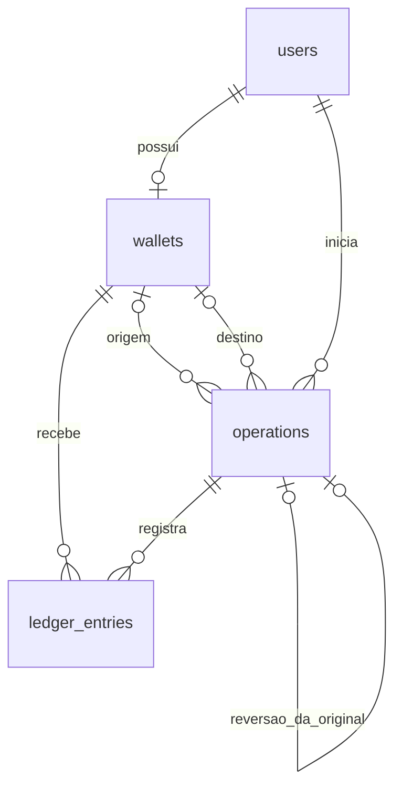

# Arquitetura da carteira financeira

A etapa 02 adicionou esquema relacional, models e testes de integridade. A etapa 03 implementa cadastro transacional, autenticação por sessão e interface inicial. Controllers financeiros, WalletService e movimentações ainda não existem. O comportamento transacional financeiro descrito aqui continua planejado para uma etapa posterior.

## Estrutura MVC e responsabilidades

- `routes/`: agrupa rotas de visitantes em `guest` e dashboard/logout em `auth`, sem lógica de aplicação nas closures.
- `app/Http/Controllers/`: coordena entrada e resposta; os controllers de autenticação usam recursos nativos e delegam criação de conta ao serviço. Nenhum controller calcula ou modifica saldos financeiros.
- `app/Models/`: dados, casts e relacionamentos Eloquent; nenhuma movimentação automática.
- `resources/views/`: layout compartilhado e páginas de início, cadastro, login e dashboard em Blade/Bootstrap 5 local.
- `database/migrations/`: evolução e integridade do esquema; migrations padrão executadas permanecem intactas.
- `tests/Feature/WalletSchemaTest.php`: restrições verificadas no MySQL `testing`, com fixtures revertidas por transação, sem reset de banco.
- Futura `app/Services/WalletService.php`: coordenará depósitos, transferências e reversões. Não foi criada nesta etapa.

Usar Eloquent e os recursos transacionais do Laravel. Form Requests validam as entradas de autenticação. Policies/Gates financeiros serão definidos com os casos de uso futuros, junto às verificações do serviço. Não adicionar repositórios, interfaces ou patterns sem necessidade concreta.

## Cadastro e autenticação implementados na etapa 03

`RegisterRequest` valida nome, e-mail único normalizado e senha confirmada. `RegisteredUserController` recebe o serviço concreto `RegisterUser` por injeção de dependência. Esse serviço usa `DB::transaction()` para criar usuário com `Hash::make()` e uma carteira vinculada ao usuário recém-criado, com zero centavos. Uma falha na carteira desfaz também o usuário; não cria operação ou lançamento inicial. A restrição única de usuário continua impedindo carteiras duplicadas.

O controller inicia a sessão somente após o serviço retornar com sucesso. Falhas SQL do cadastro geram mensagem genérica sem expor ou registrar SQL, parâmetros ou hashes de senha. Não há observer de `User`: factories e usuários antigos não recebem carteiras silenciosamente. A responsabilidade do serviço é cadastro, não execução financeira; não existe WalletService financeiro.

`LoginRequest` valida credenciais e usa `Auth::attempt()` com o guard `web`, provider Eloquent e sessão nativa. Mensagens de falha não distinguem e-mail inexistente de senha incorreta. RateLimiter nativo limita cinco falhas por e-mail/IP e vinte por IP em 60 segundos, com chaves em hash. O sucesso limpa o contador do par; não elimina o limite global do IP. `PasswordByteLimit` é uma regra compartilhada pelos dois formulários para rejeitar mais de 72 bytes e evitar truncamento do bcrypt.

Após login/cadastro, a sessão é regenerada. Logout é somente POST autenticado, chama `logout()`, invalida a sessão e regenera CSRF. Formulários usam `@csrf`, e senhas nunca usam `old()` nem são registradas em logs pela aplicação. Não há recuperação de senha ou autenticação persistente por remember-me.

`DashboardController` consulta exclusivamente `$request->user()->wallet()`. Parâmetros `user_id`/`wallet_id` da requisição não selecionam registros. Carteira ausente em usuários antigos produz mensagem e não cria dados na consulta. `BrazilianCurrency` formata centavos como texto, sem float e cobrindo os limites de inteiro de 64 bits. Os valores exibidos são escapados pelo Blade.

O frontend usa Bootstrap 5.3.8, CSS próprio e o componente Collapse para navegação móvel. Vite compila todos os assets locais, sem CDN ou fontes externas. Não há novo pacote PHP, Repository Pattern, interfaces artificiais ou operações financeiras. A separação entre Request, controller, serviço, model e apresentação aplica responsabilidade única sem abstrações extras.

## Entidades e relacionamentos

| Model | Responsabilidade e relacionamentos |
| --- | --- |
| `User` | Reutiliza `users`; `wallet()` é `HasOne`. |
| `Wallet` | Pertence ao usuário via `user()`; possui `ledgerEntries()`; guarda saldo materializado. |
| `Operation` | Registro de movimentação confirmada; `initiatedByUser()`, `sourceWallet()`, `destinationWallet()`, `ledgerEntries()`, `originalOperation()` e `reversal()`. |
| `LedgerEntry` | Débito ou crédito; pertence a `operation()` e `wallet()`. |

A FK única de usuário garante **no máximo uma** carteira, não obriga a existência de uma. O fluxo de cadastro da etapa 03 cria usuário e carteira atomicamente; usuários antigos não são alterados nem recebem carteira automaticamente.

Models financeiros mantêm a proteção padrão do Eloquent contra mass assignment. O futuro serviço atribuirá atributos explicitamente a partir de dados validados. Não passar `request()->all()` a `create()`, `update()` ou `forceFill()`. `forceCreate()` aparece apenas nas fixtures.

## Tipos, restrições e índices

Valores monetários usam `BIGINT` assinado e casts PHP `integer`, no runtime de 64 bits. O intervalo é −9.223.372.036.854.775.808 a 9.223.372.036.854.775.807 centavos. A entrada e as somas futuras precisam validar limites antes de operar, evitando overflow. Não usar `FLOAT`, `DOUBLE` ou aritmética monetária de ponto flutuante.

| Tabela | Integridade e índices |
| --- | --- |
| `wallets` | PK `id`; FK `user_id → users.id`; `UNIQUE(user_id)`; `balance_cents` assinado, default 0, aceita negativo. |
| `operations` | PK `id`; FKs para iniciador, origem, destino e operação original; `UNIQUE(idempotency_key)` global; `UNIQUE(reversal_of_operation_id)` nullable; índices `(initiated_by_user_id, created_at)`, `(source_wallet_id, created_at)` e `(destination_wallet_id, created_at)`. |
| `ledger_entries` | PK `id`; FKs para operação e carteira; `UNIQUE(operation_id, wallet_id)`; índice `(wallet_id, created_at)` para extratos. |

Todas as FKs financeiras são restritivas na exclusão e na atualização de identificadores, sem `CASCADE` ou `SET NULL`. Nas FKs de `operations` usadas em `CHECK`s, omitir ações referenciais usa o padrão `NO ACTION`, equivalente a `RESTRICT` no InnoDB. Isso evita a limitação do MySQL para ações referenciais explícitas em colunas de `CHECK`.

O Schema Builder do Laravel 12 não fornece uma API de `CHECK`; as migrations usam `DB::statement()` com SQL estático, direcionado a MySQL 8.4. Os testes de esquema não usam SQLite.

Oito `CHECK`s são aplicados:

1. `operations_amount_positive`: valor maior que zero.
2. `operations_type_valid`: `deposit`, `transfer` ou `reversal`.
3. `operations_status_valid`: `completed` ou `reversed`.
4. `operations_reversal_completed`: reversão permanece `completed`.
5. `operations_idempotency_not_blank`: chave não vazia nem composta apenas por espaços.
6. `operations_reversal_reference`: apenas reversões possuem referência original, obrigatória nesse caso.
7. `operations_wallet_shape`: depósito tem apenas destino; transferência tem duas carteiras distintas; reversão tem ao menos uma carteira e, se houver duas, são distintas.
8. `ledger_entries_delta_nonzero`: lançamento diferente de zero.

`type`, `status` e `idempotency_key` usam `utf8mb4_bin`, sensível a maiúsculas/minúsculas. A chave possui até 128 caracteres. O futuro contrato HTTP rejeitará espaços nas extremidades; a comparação de espaços finais ainda segue a collation MySQL. Recomenda-se UUID canônico para clientes, sem exigir seu formato no esquema atual.

## Ciclo de vida e auditoria

Depósitos e transferências são persistidos como `completed` na mesma transação que grava lançamentos e saldos. Não há estados `pending` ou `failed`: falha antes do commit desfaz todas as escritas e poderá gerar logs sanitizados.

Uma reversão cria outra operação `completed`, referencia a original e insere lançamentos compensatórios. Na mesma transação, a original muda para `reversed`. Seus valores, participantes, chave e lançamentos permanecem intactos. `updated_at` registra a mudança de estado; a compensação tem timestamps próprios.

`reversed` é terminal. Uma operação de tipo `reversal` não poderá ser revertida. A referência original única impede múltiplas reversões; como só se registram reversões confirmadas, não é necessário índice parcial por status.

## Transações e concorrência planejadas

Toda movimentação futura usará `DB::transaction()`. Operação, lançamentos, saldos e status da original em reversões pertencem ao mesmo commit.

O serviço deverá autenticar/autorizar o ator, validar centavos e limites, tratar idempotência e obter `lockForUpdate()` nas carteiras. Bloquear carteiras em ordem crescente de `id` em todos os fluxos reduz deadlocks. Verificar saldo suficiente somente depois do bloqueio.

Reversões bloquearão primeiro a operação original, verificarão tipo, estado e ausência de reversão e depois bloquearão as carteiras na ordem definida. Revalidar autorização dentro da transação. Deadlocks terão repetição limitada da unidade transacional, sem repetir efeitos externos.

A chave idempotente única é a proteção final contra corridas. Comparar iniciador e conteúdo financeiro da operação existente. Mesma chave com conteúdo diferente gera conflito. Em disputa concorrente, reverter a transação perdedora antes de recuperar a vencedora e reaplicar as verificações de autorização. Não capturar violação de unicidade e continuar uma movimentação incompleta.

## Limites para revisão

FKs e `CHECK`s não garantem condições entre múltiplas linhas/tabelas. A futura camada de serviço deverá assegurar:

- Existência de carteira para usuários antigos e autorização dos futuros casos de uso financeiros. O cadastro novo já cria a carteira e o dashboard já restringe a consulta ao ator.
- Conciliação do saldo materializado com a soma dos lançamentos.
- Exatamente um crédito por depósito e dois lançamentos opostos por transferência, pelos valores corretos.
- Correspondência entre carteiras dos lançamentos e da operação.
- Mesmo valor e participantes invertidos na reversão; original de tipo depósito/transferência, ainda `completed`.
- Atualização conjunta do histórico e do status, autorização e imutabilidade dos registros confirmados.

Não há triggers ou observers executando regras silenciosamente. A unicidade `(operation_id, wallet_id)` assume um lançamento por carteira em cada operação deste desafio. Depósitos são entradas simuladas; sem conta externa de contrapartida, este modelo não é uma contabilidade geral de partidas dobradas.

FKs impedem exclusões de pais referenciados, mas não tornam lançamentos folha imutáveis contra SQL direto. Models não autorizam acesso apenas por exporem relacionamentos. Ver [BUSINESS_RULES.md](BUSINESS_RULES.md) para o contrato de autorização.

## Organização e segurança

O phpMyAdmin oficial `phpmyadmin:5.2.3-apache` publica apenas `127.0.0.1:8089`, na rede `sail`, apontando a `mysql:3306`. Usa login normal por cookie, sem `PMA_USER`/`PMA_PASSWORD`. Utilizar a conta de desenvolvimento do `.env`; não adicionar armazenamento de configuração do phpMyAdmin nem modificar o volume MySQL.

Não registrar credenciais ou conteúdo do `.env` em logs, respostas e commits. A conta MySQL local permite manutenção de esquema; uma futura produção exigirá permissões mínimas e proteção específica do histórico. Não operar dados financeiros reais nesta simulação.

Referências: [migrations Laravel 12](https://laravel.com/docs/12.x/migrations), [CHECKs MySQL 8.4](https://dev.mysql.com/doc/refman/8.4/en/create-table-check-constraints.html), [imagem oficial phpMyAdmin](https://hub.docker.com/_/phpmyadmin) e [OWASP Top 10:2025](https://owasp.org/Top10/2025/).

Referências da etapa 03: [autenticação nativa Laravel 12](https://laravel.com/docs/12.x/authentication), [RateLimiter](https://laravel.com/docs/12.x/rate-limiting) e [Bootstrap com Vite](https://getbootstrap.com/docs/5.3/getting-started/vite/).
